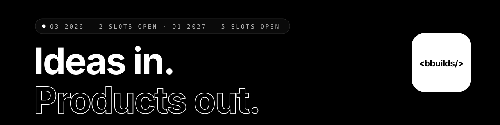

### Ideas in. Products out.

**BBuilds** is a one-team product studio for **zero-to-one software**. Strategy, design, and engineering under a single roof — you bring the raw idea, we hand back shipped software with real users.

`ZERO TO ONE ✦ PRODUCT DESIGN ✦ FULL-STACK ENGINEERING ✦ AI FEATURES ✦ LAUNCH & GROWTH ✦ DESIGN SYSTEMS`

---

## ✦ What we do

**Everything between idea and shipped.** One studio, the full stack of skills. Pick a slice, or hand us the whole thing and go back to running your company.

| | |
|:---|:---|
| **Zero-to-One MVPs** | Scope cut to whatever proves the thesis, built and live in weeks. For founders who need signal from the market, not signal from a slide deck. |
| **Product Design** | Research, flows, interfaces, and design systems with a point of view. Pretty is table stakes — usable is the actual product. |
| **Web Engineering** | Next.js, TypeScript, Postgres — fast by default, boring to maintain, and ready for the traffic spike you're hoping for. |
| **AI-Native Features** | Copilots, agents, and automations wired into real workflows — where LLMs earn their keep instead of just demoing well. |
| **Launch & Growth** | Analytics, onboarding, and iteration loops wired in from day one, so a launch turns into traction instead of a tweet. |
| **Studio Retainer** | An embedded senior product team on tap — strategy through shipped feature, with no hiring line and no handoff loss. |

## ✦ How we ship

**Five steps. No mystery.** The complexity stays in the codebase, not the calendar.

1. **Scope** — we interrogate the idea until only the essential survives. You get a build plan with real dates before we write a single line.
2. **Design** — flows, screens, and a system — reviewed in the open and iterated daily. Nothing ships that's pretty only for pretty's sake.
3. **Build** — a weekly shipping cadence. You watch the product grow in staging, not in progress meetings or slide decks.
4. **Launch** — domain, deploy, analytics, onboarding — the unglamorous 10% that decides whether anyone actually uses the thing.
5. **Iterate** — data in, updates out. The first launch buys the lesson; v2 is where the compounding starts.

## ✦ The studio in four lines

1. **Ship or it didn't happen.**
2. **Taste is a feature.**
3. **Senior only. Small on purpose.**
4. **Black and white: we say what we'll do, then do it.**

## ✦ Receipts

| `10+` | `4–8 wks` | `92%` | `0` |
|:---:|:---:|:---:|:---:|
| Products shipped | Idea → first launch | Clients come back | Vaporware delivered |

> "BBuilds is the rare studio that argues with you when you're wrong — and is right often enough that you listen. Our MVP shipped in six weeks. It now drives 80% of our revenue."
> — **R. Menon**, Co-founder & CEO · Ledgerline

## ✦ Start something

Tell us what you're trying to ship. We reply within 48 hours — with actual thoughts, not a sales deck.

| | |
|:---|:---|
| **Website** | [bbuilds.org](https://bbuilds.org) |
| **Email** | [hello@bbuilds.studio](mailto:hello@bbuilds.studio) |
| **Availability** | 2 slots open · Q1 2027 |
| **Working hours** | Remote-first · IST & PST overlap |

---

© 2026 BBuilds Studio · <a href="https://bbuilds.org">bbuilds.org</a> · Built in black &amp; white. Zero gradients were harmed.

